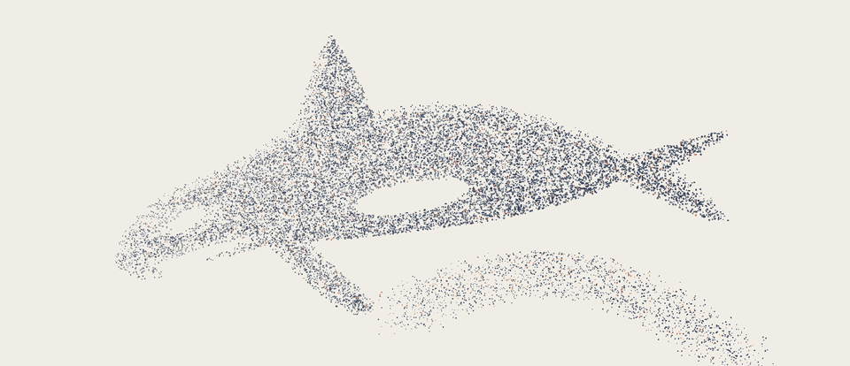

<h1>Lukas Chudy</h1>

<a href="https://lukaschudy.github.io/lukaschudy/orca/" title="Open the interactive particle orca">
  <picture>
    <source media="(prefers-color-scheme: dark)" srcset="./assets/orca-particles-dark.gif">
    <source media="(prefers-color-scheme: light)" srcset="./assets/orca-particles.gif">
    
  </picture>
</a>

I used to play League of Legends professionally. Now I'm based in London and studying MSc Mathematics at LSE and am also practising competitive programming.

I work mainly with C++, PostgreSQL, AWS, and Cloudflare
